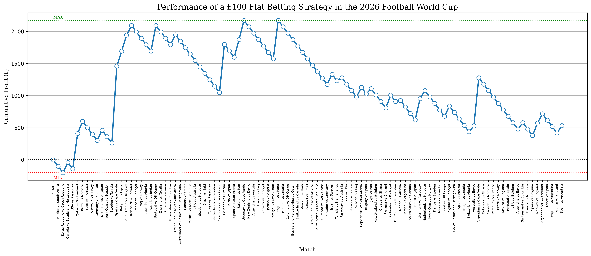

# 2026 FIFA World Cup: Flat-Betting Strategy Analysis

## Overview

This project uses Python to evaluate the historical performance of a flat-betting strategy during the 2026 FIFA World Cup.

The strategy involves placing a hypothetical £100 bet on a draw in every match and tracking cumulative profit or loss throughout the tournament.

The project was developed independently to practise web scraping, data processing, quantitative analysis and visualisation using Python.

## Data Sources

- **Match results:** [Sky Sports](https://www.skysports.com/fifa-world-cup-scores-fixtures/2026-06-01), automatically extracted using Python's `requests` and `BeautifulSoup` libraries.
- **Historical betting odds:** [OddsPortal](https://www.oddsportal.com/football/world/world-championship-2026/results/), manually collected and entered into the Python script.

## Methodology

1. Retrieve World Cup match results from Sky Sports for June and July 2026.
2. Extract team names, scores and match statuses using BeautifulSoup.
3. Combine the results into a chronological sequence of matches.
4. Match each fixture with its corresponding manually collected betting odds.
5. Simulate a £100 stake on a draw in each match.
6. Calculate cumulative profit or loss and visualise the results using Matplotlib.

For decimal odds, the simulation calculates the net return on a winning bet as:

**Profit = £100 × (decimal odds − 1)**

A losing bet incurs a £100 loss.

## Results

The program generates a graph showing cumulative profit or loss across the tournament.



## Technologies Used

- Python
- Requests (retrieving webpage content)
- BeautifulSoup (extracting HTML data)
- Matplotlib (data visualisation)

## How to Run

Install the required libraries:

```bash
pip install requests beautifulsoup4 matplotlib
```

Run the Python script:

```bash
python world_cup_analysis.py
```

The program retrieves match information, calculates the simulated returns and generates a graph.

## Limitations

- Betting odds were manually collected rather than automatically extracted.
- The analysis assumes that the odds correspond to the correct fixtures and the relevant draw market.
- Match statuses and final scores may not always distinguish 90-minute results from outcomes after extra time or penalties.
- Changes to the source websites could affect the web-scraping process.
- Historical performance does not establish that the strategy would be profitable in future tournaments.

## Disclaimer

This is an exploratory Python data-analysis project, not a predictive machine-learning model or a recommendation to gamble.

This README was created with the assistance of AI.
